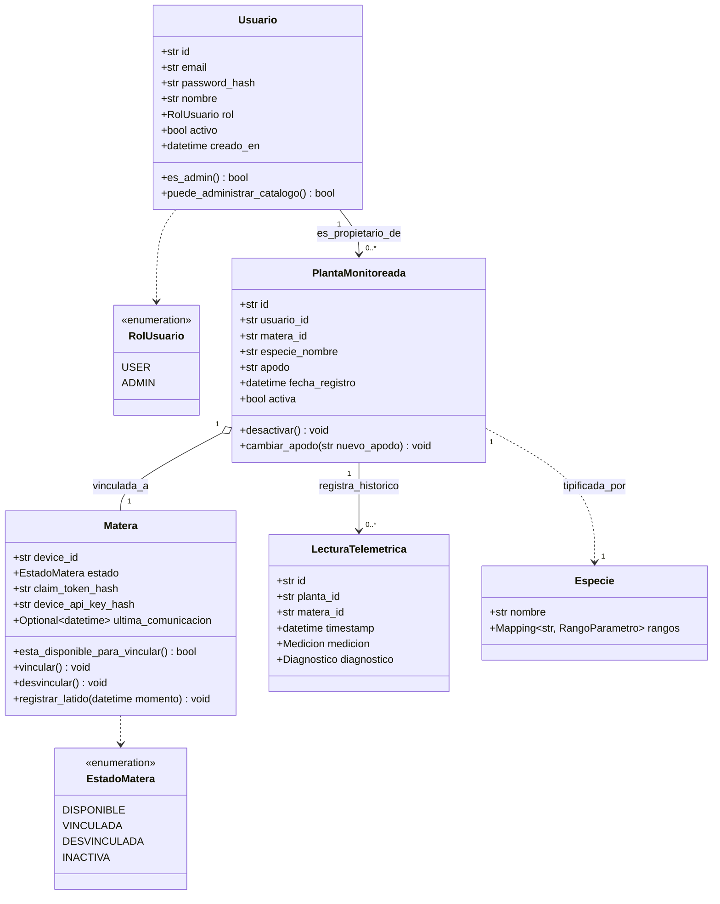
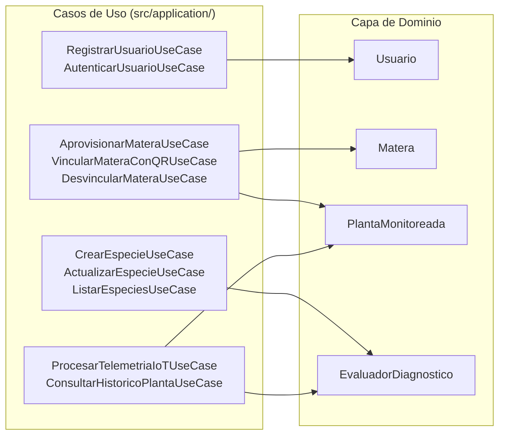
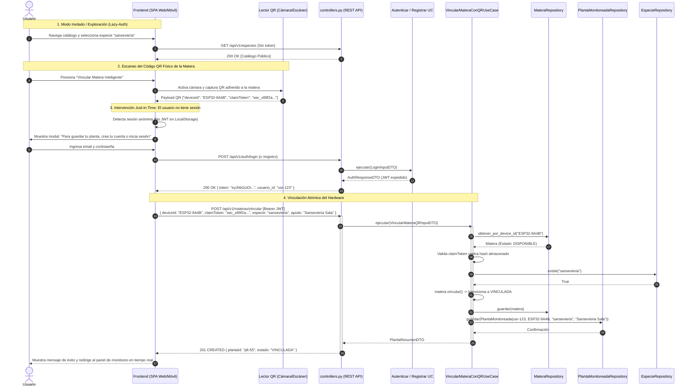
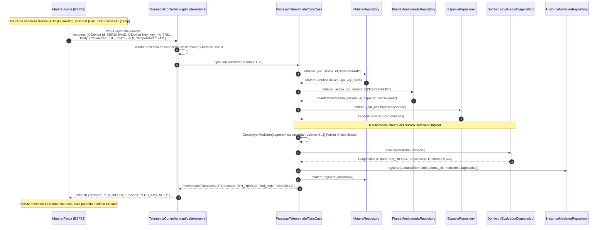
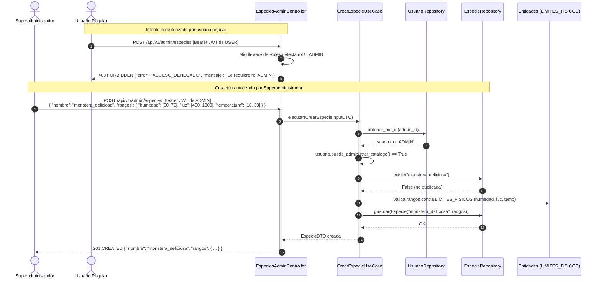

# Diseño Arquitectónico: Gestión de Usuarios, Gobernanza Botánica y Vinculación de Hardware IoT (Matera ESP32)
**Proyecto Matera Inteligente · SmartPlantBase**  
**Semestre 2026-2 · Arquitectura de Software**

---

## 1. Contexto, Propósito y Principios de Diseño

### 1.1 Contexto de la Evolución
En la fase inicial de **SmartPlantBase**, el sistema resolvió de forma estricta el **núcleo de diagnóstico botánico**: un servicio desacoplado que, a partir de mediciones ambientales (humedad, luz, temperatura) y una especie de referencia, clasifica parámetros, deriva el estado global de la planta y emite recomendaciones agronómicas bajo **Clean Architecture** y principios **SOLID**.

En esta siguiente etapa evolutiva, el sistema se expande para soportar:
1. **Gestión de Usuarios y Roles (RBAC):** Diferenciación entre usuarios regulares y Superadministradores del sistema.
2. **Gobernanza del Catálogo Botánico:** Protección del catálogo de especies para evitar nombres duplicados, parámetros inconsistentes o umbrales agronómicamente peligrosos.
3. **Hardware IoT (ESP32):** Integración de microcontroladores físicos embebidos en las materas para captura y transmisión autónoma de telemetría ambiental.
4. **Vinculación de Matera y Planta vía Código QR:** Mecanismo seguro y transparente que permite a un usuario vincular una matera física a su cuenta, asociándole una planta y su correspondiente especie.
5. **Experiencia de Usuario con Lazy-Authentication (Lazy-Auth UX):** Los usuarios pueden explorar el catálogo botánico e interactuar con el simulador de diagnóstico sin barreras de entrada; solo cuando deciden vincular una matera o persistir sus plantas, el sistema solicita autenticación justo a tiempo (*Just-in-Time Auth*).

### 1.2 Regla de Oro Arquitectónica: Invarianza del Núcleo de Dominio
El principio fundamental que rige este diseño (y la métrica central de evaluación del curso) es la **independencia del dominio**:
> **El evaluador de diagnóstico (`EvaluadorDiagnostico`), los límites físicos universales (`LIMITES_FISICOS`) y la entidad `Medicion` NO sufren modificaciones.**  
> La llegada de usuarios, hardware ESP32 y códigos QR representa un crecimiento perimetral (nuevas entidades satélite, nuevos casos de uso y nuevos adaptadores de entrada/salida), preservando el núcleo botánico original intacto (**0 líneas de código modificadas en las reglas existentes**).

---

## 2. Requisitos del Sistema

### 2.1 Requisitos Funcionales (RF)

#### A. Autenticación y Control de Acceso (RBAC)
- **RF-AUTH-01 (Registro e Identidad):** El sistema permite el registro de nuevos usuarios mediante correo electrónico, contraseña robusta y nombre.
- **RF-AUTH-02 (Inicio de Sesión y Tokens):** El sistema autentica credenciales de usuario y expide credenciales de sesión desacopladas (JSON Web Tokens - JWT con tiempo de expiración).
- **RF-AUTH-03 (Roles del Sistema):**
  - **Usuario Regular (`USER`):** Puede registrarse, iniciar sesión, gestionar sus plantas, vincular/desvincular sus materas físicas, consultar la telemetría histórica de sus plantas y consultar el catálogo botánico público.
  - **Superadministrador (`ADMIN`):** Posee todos los permisos de `USER`, además de la administración exclusiva del catálogo de especies (crear, editar, archivar) y el aprovisionamiento de lotes de hardware.
- **RF-AUTH-04 (Lazy-Auth UX):** Las operaciones de consulta del catálogo de especies (`GET /api/v1/especies`) y el diagnóstico manual ad-hoc (`POST /api/v1/diagnosticos`) permanecen públicas y accesibles sin requerir autenticación previa.

#### B. Gobernanza del Catálogo Botánico (`Especie`)
- **RF-CAT-01 (Autoridad Exclusiva de Creación):** Solo los usuarios con rol `ADMIN` pueden dar de alta nuevas especies botánicas en el catálogo global.
- **RF-CAT-02 (Validación Estricta de Umbrales):** Toda nueva especie debe definir obligatoriamente rangos para todas las variables ambientales soportadas en el dominio (`PARAMETROS_SOPORTADOS`). Los valores mínimos no pueden superar a los máximos y deben situarse dentro de los límites físicos plausibles (`LIMITES_FISICOS`).
- **RF-CAT-03 (Prevención de Conflictos y Duplicados):** El identificador/nombre de la especie es único y normalizado (minúsculas, sin espacios superfluos ni caracteres especiales confusos). Se rechazan intentos de registrar nombres redundantes para garantizar que las lecturas de sensores comparen siempre contra un estándar agronómico validado.
- **RF-CAT-04 (Consulta Pública):** Todos los usuarios (anónimos o autenticados) pueden listar y consultar los rangos de referencia de las especies aprobadas.

#### C. Ciclo de Vida del Hardware (Matera ESP32)
- **RF-HW-01 (Identidad del Dispositivo):** Cada matera física cuenta con un identificador único global inmutable (`device_id`, derivado de su MAC address o UUID de hardware) y un secreto criptográfico de aprovisionamiento (`claim_token`).
- **RF-HW-02 (Aprovisionamiento de Fábrica):** El sistema permite al Superadmin registrar lotes de materas fabricadas en estado `DISPONIBLE`, almacenando el hash del `claim_token` y generando el payload del código QR físico.
- **RF-HW-03 (Estados del Hardware):** La matera transiciona por los estados:
  - `DISPONIBLE`: Fabricada, con QR emitido, en espera de ser reclamada por un usuario.
  - `VINCULADA`: Asignada activamente a un usuario y a una instancia de planta.
  - `DESVINCULADA`: Liberada por el usuario; lista para reasignación.
  - `INACTIVA`: Dada de baja por avería o mantenimiento.
- **RF-HW-04 (Autenticación Hardware para Telemetría):** Cada matera posee una clave de dispositivo (`device_api_key`), independiente de las credenciales de los usuarios, utilizada exclusivamente por el firmware del ESP32 para autenticar la ingesta de telemetría.

#### D. Vinculación de Matera y Planta vía Código QR
- **RF-BIND-01 (Carga de QR por el Usuario):** El usuario escanea o ingresa el contenido del código QR de la matera física desde la aplicación.
- **RF-BIND-02 (Verificación de Reclamo):** El sistema valida que la matera exista, se encuentre en estado `DISPONIBLE` (o `DESVINCULADA`) y que el `claim_token` suministrado coincida con el hash registrado.
- **RF-BIND-03 (Creación de Planta de Usuario):** En una transacción atómica, el sistema:
  1. Marca la matera como `VINCULADA`.
  2. Crea la entidad `PlantaMonitoreada` asociada al `usuario_id`, al `device_id` y a la `especie` seleccionada por el usuario.
  3. Asigna un apodo personalizado a la planta (p. ej., *"Mi Sansevieria de la sala"*).
- **RF-BIND-04 (Desvinculación y Reclamación Segura):** El usuario propietario puede desvincular la matera. Al hacerlo, la planta se archiva o desvincula y la matera retorna al estado `DESVINCULADA` para permitir su transferencia a otro usuario o su reutilización con otra especie.

#### E. Ingesta de Telemetría IoT y Diagnóstico Continuo
- **RF-IOT-01 (Ingesta Periódica):** El ESP32 envía periódicamente (p. ej., cada 10 a 60 minutos) una carga útil de telemetría conteniendo sus lecturas brutas de sensores (`humedad`, `luz`, `temperatura`) identificándose con su `device_id` y su `device_api_key`.
- **RF-IOT-02 (Enrutamiento de Contexto):** Al recibir la telemetría, el sistema busca la `PlantaMonitoreada` activa asociada a dicho `device_id` y extrae su especie botánica asignada.
- **RF-IOT-03 (Diagnóstico Automático):** El sistema construye la entidad de dominio `Medicion`, invoca el caso de uso existente con el `EvaluadorDiagnostico` y genera el diagnóstico en tiempo real.
- **RF-IOT-04 (Persistencia de Histórico):** Cada lectura y su diagnóstico resultante se almacenan en un repositorio de histórico de mediciones vinculado a la planta.
- **RF-IOT-05 (Respuesta / Feedback al Hardware):** La API responde al ESP32 con el estado global calculado (`SALUDABLE`, `EN_RIESGO`, `CRITICO`), permitiendo al hardware accionar indicadores físicos (p. ej., LED verde, amarillo o rojo en la matera física).

---

### 2.2 Requisitos No Funcionales (RNF)

- **RNF-01 (Independencia del Dominio - RA4 / DIP):** Las entidades de dominio `Usuario`, `Matera` y `PlantaMonitoreada` son clases puras de Python. No tienen dependencias de Flask, SQLAlchemy, bibliotecas criptográficas específicas de infraestructura (como bcrypt/pyjwt), ni detalles de red.
- **RNF-02 (Seguridad contra Ataques de Fuerza Bruta / Replay en QR):**
  - El código QR no expone contraseñas de red ni credenciales maestras.
  - El `claim_token` es un secreto de alta entropía (mínimo 128 bits pseudoaleatorios) emitido en fábrica.
  - Conocer únicamente el `device_id` (impreso o inferible) es insuficiente para vincular una matera; se requiere indefectiblemente el `claim_token`.
  - Las contraseñas de usuario se almacenan mediante funciones de derivación seguras (Argon2id o BCrypt con factor de costo adecuado).
- **RNF-03 (Aislamiento de Credenciales IoT):** El microcontrolador ESP32 nunca almacena ni transmite credenciales de usuario (correos o contraseñas). Utiliza una clave simétrica por hardware (`device_api_key`) inyectada en memoria no volátil (NVS) protegida.
- **RNF-04 (Tolerancia a Conectividad Intermitente IoT):** La API de telemetría procesa lecturas con marcas temporales explícitas enviadas por el ESP32 (con soporte RTC o NTP) o asigna el timestamp de recepción en caso de discrepancias, garantizando la consistencia temporal del histórico.
- **RNF-05 (Rendimiento de Ingesta):** El endpoint de telemetría responde en menos de 100 ms para minimizar el tiempo de conexión activa del microcontrolador y maximizar la vida útil de la batería de la matera.
- **RNF-06 (Transaccionalidad e Idempotencia):** La vinculación de matera es idempotente frente a reintentos de red del cliente móvil/web.

---

## 3. Modelo de Dominio y Entidades

El dominio botánico original permanece idéntico en su archivo [`src/domain/entities.py`](file:///home/esteban/Documents/COLLEGE/2026-2/ARQUIT/SmartPlantBase/src/domain/entities.py): `LimiteFisico`, `RangoParametro`, `Especie`, `Medicion`, `Diagnostico`, `ParametroEvaluado`, `EstadoParametro`, `EstadoPlanta`.

Se introducen nuevas entidades y objetos de valor dentro del dominio para modelar usuarios, hardware y plantas:



### 3.1 Definición Conceptual de las Entidades Nuevas

1. **`Usuario` (Entidad de Dominio):**
   - Representa al actor humano dentro del sistema.
   - Posee un método `es_admin() -> bool` para consulta semántica de privilegios sin acoplarse a frameworks de seguridad.
   - Sus invariantes exigen formato de email válido y nombre no vacío.

2. **`Matera` (Entidad de Dominio IoT):**
   - Modela el contenedor físico y su placa ESP32.
   - Su identidad no es un ID artificial de base de datos, sino su identificador de hardware único `device_id` (p. ej., `ESP32-A4E57C9B10`).
   - Contiene la máquina de estados del hardware (`DISPONIBLE`, `VINCULADA`, `DESVINCULADA`, `INACTIVA`).
   - Protege los invariantes de hardware: no es posible vincular una matera que ya se encuentre en estado `VINCULADA` ni procesar telemetría de una matera `INACTIVA`.

3. **`PlantaMonitoreada` (Agregado de Dominio):**
   - Es el punto de unión (*Aggregate Root*) entre el usuario (`usuario_id`), el dispositivo sensor (`matera_id`) y la biología de referencia (`especie_nombre`).
   - Mantiene la trazabilidad de la vida de la planta del usuario independientemente de que la matera sea sustituida o transferida en el futuro.

4. **`LecturaTelemetrica` (Objeto de Valor / Entidad de Histórico):**
   - Agrupa la marca de tiempo, los valores físicos capturados (`Medicion`), el diagnóstico generado (`Diagnostico`) y las referencias a la planta y matera de origen.

---

## 4. Puertos del Dominio (Domain Ports / Abstracciones)

De acuerdo con el principio de Inversión de Dependencias (**DIP / RA5**), la capa de dominio declara los contratos abstractos necesarios para interactuar con la persistencia, la criptografía y la generación de tokens:

```python
# src/domain/repositories.py (Nuevos puertos que acompañan a EspecieRepository)

from abc import ABC, abstractmethod
from typing import List, Optional
from src.domain.entities import Usuario, Matera, PlantaMonitoreada, LecturaTelemetrica, Especie

class UsuarioRepository(ABC):
    @abstractmethod
    def obtener_por_id(self, usuario_id: str) -> Optional[Usuario]:
        pass

    @abstractmethod
    def obtener_por_email(self, email: str) -> Optional[Usuario]:
        pass

    @abstractmethod
    def guardar(self, usuario: Usuario) -> None:
        pass


class MateraRepository(ABC):
    @abstractmethod
    def obtener_por_device_id(self, device_id: str) -> Optional[Matera]:
        pass

    @abstractmethod
    def guardar(self, matera: Matera) -> None:
        pass


class PlantaMonitoreadaRepository(ABC):
    @abstractmethod
    def obtener_por_id(self, planta_id: str) -> Optional[PlantaMonitoreada]:
        pass

    @abstractmethod
    def obtener_activa_por_matera_id(self, matera_id: str) -> Optional[PlantaMonitoreada]:
        pass

    @abstractmethod
    def listar_por_usuario(self, usuario_id: str) -> List[PlantaMonitoreada]:
        pass

    @abstractmethod
    def guardar(self, planta: PlantaMonitoreada) -> None:
        pass


class HistoricoMedicionRepository(ABC):
    @abstractmethod
    def registrar(self, lectura: LecturaTelemetrica) -> None:
        pass

    @abstractmethod
    def obtener_ultimas_lecturas(self, planta_id: str, limite: int = 50) -> List[LecturaTelemetrica]:
        pass


class EspecieRepository(ABC):
    """Extensión del puerto existente: se añaden operaciones de persistencia para el Superadmin."""
    @abstractmethod
    def obtener_por_nombre(self, nombre: str) -> Optional[Especie]:
        pass

    @abstractmethod
    def obtener_todas(self) -> List[Especie]:
        pass

    @abstractmethod
    def guardar(self, especie: Especie) -> None:
        pass

    @abstractmethod
    def existe(self, nombre: str) -> bool:
        pass
```

### Puertos de Seguridad y Criptografía (Aislamiento de Infraestructura)

Para evitar que el dominio conozca `bcrypt`, `argon2` o `jwt` (violación de **RA4**), el dominio declara puertos para servicios criptográficos:

```python
# src/domain/security.py

class PasswordHasherPort(ABC):
    @abstractmethod
    def hashear(self, password_plana: str) -> str:
        pass

    @abstractmethod
    def verificar(self, password_plana: str, password_hasheada: str) -> bool:
        pass


class TokenServicePort(ABC):
    @abstractmethod
    def generar_token(self, usuario: Usuario) -> str:
        pass

    @abstractmethod
    def validar_y_obtener_payload(self, token: str) -> Optional[dict]:
        pass
```

---

## 5. Capa de Aplicación: Casos de Uso y DTOs

La capa de aplicación orquesta la interacción entre las entidades, las reglas de negocio y los puertos de infraestructura.



### 5.1 Catálogo de Casos de Uso

| Módulo | Caso de Uso | Actores | Descripción |
| :--- | :--- | :--- | :--- |
| **Auth** | `RegistrarUsuarioUseCase` | Usuario anónimo | Crea un usuario con rol `USER` hasheando su contraseña mediante `PasswordHasherPort`. |
| **Auth** | `AutenticarUsuarioUseCase` | Usuario anónimo | Valida credenciales y emite un token JWT mediante `TokenServicePort`. |
| **Catálogo** | `CrearEspecieUseCase` | `ADMIN` (Superadmin) | Valida que el actor sea Superadmin, verifica que la especie no exista, valida que todos los parámetros estén en `LIMITES_FISICOS` y guarda la especie. |
| **Catálogo** | `ActualizarEspecieUseCase` | `ADMIN` (Superadmin) | Ajusta los rangos de una especie existente sin afectar los diagnósticos históricos ya emitidos. |
| **Catálogo** | `ListarEspeciesUseCase` | Anónimo / `USER` / `ADMIN` | Consulta el catálogo público (caso de uso existente en el núcleo). |
| **Hardware** | `AprovisionarMateraUseCase` | `ADMIN` (Fábrica) | Registra una nueva matera física en estado `DISPONIBLE`, almacenando el hash del `claim_token` y generando el payload del QR. |
| **Vinculación** | `VincularMateraConQRUseCase` | `USER` autenticado | Valida el payload del QR (`device_id` + `claim_token`), verifica disponibilidad, transiciona la matera a `VINCULADA` y crea la `PlantaMonitoreada`. |
| **Vinculación** | `DesvincularMateraUseCase` | `USER` propietario | Desvincula la matera de la planta y retorna el hardware a estado `DESVINCULADA`. |
| **Telemetría** | `ProcesarTelemetriaIoTUseCase` | Microcontrolador ESP32 | Recibe telemetría física, valida la API key del hardware, localiza la planta y especie activas, construye `Medicion`, ejecuta `EvaluadorDiagnostico` y persiste el histórico. |
| **Telemetría** | `ConsultarHistoricoPlantaUseCase` | `USER` propietario | Retorna la serie temporal de mediciones y estados para visualización de gráficas en el frontend. |

### 5.2 Estructura de DTOs de Entrada y Salida

```python
# src/application/dtos.py (Nuevos contratos de transferencia)

from dataclasses import dataclass
from typing import Dict, List, Optional

# --- DTOs de Autenticación ---
@dataclass(frozen=True)
class RegistroUsuarioDTO:
    email: str
    password: str
    nombre: str

@dataclass(frozen=True)
class LoginInputDTO:
    email: str
    password: str

@dataclass(frozen=True)
class AuthResponseDTO:
    token: str
    usuario_id: str
    email: str
    nombre: str
    rol: str

# --- DTOs de Gobernanza de Catálogo ---
@dataclass(frozen=True)
class CrearEspecieInputDTO:
    admin_usuario_id: str
    nombre: str
    rangos: Dict[str, Dict[str, float]]  # {"humedad": {"min": 20.0, "max": 45.0}, ...}

# --- DTOs de Hardware y Vinculación QR ---
@dataclass(frozen=True)
class AprovisionarMateraInputDTO:
    device_id: str
    claim_token_plano: str
    device_api_key_plano: str

@dataclass(frozen=True)
class VincularMateraQRInputDTO:
    usuario_id: str
    device_id: str
    claim_token: str
    especie_nombre: str
    apodo_planta: str

@dataclass(frozen=True)
class PlantaResumenDTO:
    id: str
    apodo: str
    especie: str
    device_id: str
    estado_matera: str
    fecha_registro: str

# --- DTOs de Telemetría ESP32 ---
@dataclass(frozen=True)
class TelemetriaIoTInputDTO:
    device_id: str
    device_api_key: str
    timestamp: Optional[str]
    valores: Dict[str, float]  # {"humedad": 35.2, "luz": 800.0, "temperatura": 22.5}

@dataclass(frozen=True)
class TelemetriaIoTResponseDTO:
    device_id: str
    planta_id: str
    estado_planta: str       # "SALUDABLE" | "EN_RIESGO" | "CRITICO"
    timestamp_procesado: str
    accion_recomendada: str  # Resumen para el firmware (e.g., código de color LED)
```

---

## 6. Flujos de Interacción y Diagramas de Secuencia

### 6.1 Flujo de Vinculación Matera/Planta vía Código QR con Lazy-Auth UX

Este diagrama ilustra la experiencia de un usuario nuevo que adquiere una matera inteligente física. El usuario explora libremente el catálogo, escanea el código QR de su matera y solo se le solicita autenticarse en el momento de confirmar la vinculación física (*Just-in-Time Auth*).



---

### 6.2 Flujo de Ingesta de Telemetría ESP32 y Diagnóstico en Tiempo Real

Ilustra cómo el microcontrolador físico envía lecturas periódicas al backend. Nótese cómo la llamada culmina en el `EvaluadorDiagnostico` del dominio botánico original sin tocar una sola línea de código existente.



---

### 6.3 Flujo de Gobernanza del Catálogo Botánico por Superadministrador

Garantiza que ningún usuario ordinario corrompa los rangos de referencia botánicos, centralizando la calibración en administradores acreditados.



---

## 7. Especificación de Contratos de la API REST

Todos los endpoints respetan el formato uniforme de error (**RF6**) adoptado en el proyecto base:
```json
{
  "error": "CODIGO_ERROR",
  "mensaje": "Descripción legible para el usuario o desarrollador.",
  "detalle": { "campo": "valor" }
}
```

### 7.1 Matriz de Endpoints y Seguridad

| Método | Endpoint | Nivel de Acceso | Propósito |
| :--- | :--- | :--- | :--- |
| `GET` | `/api/v1/especies` | Público (Lazy-Auth) | Listar catálogo botánico con rangos óptimos. |
| `POST` | `/api/v1/diagnosticos` | Público (Lazy-Auth) | Evaluación manual ad-hoc (simulador sin matera). |
| `POST` | `/api/v1/auth/registro` | Público | Registro de nuevo usuario regular (`USER`). |
| `POST` | `/api/v1/auth/login` | Público | Autenticación y obtención de JWT. |
| `GET` | `/api/v1/usuarios/perfil` | Autenticado (`USER`/`ADMIN`) | Obtener datos del usuario autenticado. |
| `GET` | `/api/v1/materas/mis-plantas` | Autenticado (`USER`) | Listar plantas y materas vinculadas al usuario. |
| `POST` | `/api/v1/materas/vincular` | Autenticado (`USER`) | Reclamar y vincular matera física con payload QR. |
| `DELETE` | `/api/v1/materas/{id}/desvincular` | Autenticado (`USER`) | Liberar matera física y archivar planta. |
| `GET` | `/api/v1/plantas/{id}/historico` | Autenticado (`USER`) | Consultar lecturas históricas de una planta. |
| `POST` | `/api/v1/admin/especies` | Autenticado (`ADMIN`) | Crear nueva especie botánica en el catálogo global. |
| `PUT` | `/api/v1/admin/especies/{nombre}` | Autenticado (`ADMIN`) | Actualizar rangos de una especie existente. |
| `POST` | `/api/v1/admin/materas/aprovisionar`| Autenticado (`ADMIN`) | Registrar nuevo lote de hardware y generar QRs. |
| `POST` | `/api/v1/telemetria` | Hardware (`X-Device-Key`) | Ingesta de mediciones desde el ESP32. |

---

### 7.2 Detalle de Contratos Clave

#### A. Vinculación de Matera vía QR (`POST /api/v1/materas/vincular`)
- **Headers:** `Authorization: Bearer <JWT_USER>`, `Content-Type: application/json`
- **Request Body:**
```json
{
  "deviceId": "ESP32-9A4B2C",
  "claimToken": "sec_7f9a8b1c4e2d3f0a1b2c",
  "especie": "sansevieria",
  "apodo": "Mi Sansevieria del Balcón"
}
```
- **Response 201 CREATED:**
```json
{
  "plantaId": "plt-98124",
  "apodo": "Mi Sansevieria del Balcón",
  "especie": "sansevieria",
  "deviceId": "ESP32-9A4B2C",
  "estadoMatera": "VINCULADA",
  "fechaRegistro": "2026-09-25T19:30:00Z"
}
```
- **Response 409 CONFLICT (Matera ya vinculada o en uso):**
```json
{
  "error": "MATERA_YA_VINCULADA",
  "mensaje": "La matera indicada ya se encuentra vinculada a otra planta activa.",
  "detalle": { "deviceId": "ESP32-9A4B2C" }
}
```
- **Response 401 UNAUTHORIZED (Claim Token inválido):**
```json
{
  "error": "CLAIM_TOKEN_INVALIDO",
  "mensaje": "El código QR o token de reclamo de la matera no es válido.",
  "detalle": { "deviceId": "ESP32-9A4B2C" }
}
```

---

#### B. Ingesta de Telemetría ESP32 (`POST /api/v1/telemetria`)
- **Headers:**  
  `X-Device-Id: ESP32-9A4B2C`  
  `X-Device-Key: key_hw_88192a9c3d4e`  
  `Content-Type: application/json`
- **Request Body:**
```json
{
  "timestamp": "2026-09-25T19:35:12Z",
  "humedad": 18.2,
  "luz": 850.0,
  "temperatura": 22.4
}
```
- **Response 200 OK:**
```json
{
  "deviceId": "ESP32-9A4B2C",
  "plantaId": "plt-98124",
  "estadoPlanta": "EN_RIESGO",
  "feedbackHardware": {
    "indicadorLed": "AMARILLO",
    "frecuenciaMuestreoSugeridaSegundos": 900
  },
  "diagnosticoResumen": {
    "desviaciones": 1,
    "parametroAfectado": "humedad"
  }
}
```
- **Response 401 UNAUTHORIZED (Hardware no autorizado):**
```json
{
  "error": "DISPOSITIVO_NO_AUTORIZADO",
  "mensaje": "La clave del dispositivo o el identificador no coinciden.",
  "detalle": { "deviceId": "ESP32-9A4B2C" }
}
```
- **Response 422 UNPROCESSABLE ENTITY (Matera huérfana / no vinculada a planta):**
```json
{
  "error": "MATERA_SIN_PLANTA",
  "mensaje": "El dispositivo está registrado pero aún no ha sido vinculado a una planta por un usuario.",
  "detalle": { "deviceId": "ESP32-9A4B2C" }
}
```

---

#### C. Alta de Especie por Superadmin (`POST /api/v1/admin/especies`)
- **Headers:** `Authorization: Bearer <JWT_ADMIN>`, `Content-Type: application/json`
- **Request Body:**
```json
{
  "nombre": "ficus_lyrata",
  "rangos": {
    "humedad": { "min": 35.0, "max": 60.0 },
    "luz": { "min": 600.0, "max": 2000.0 },
    "temperatura": { "min": 18.0, "max": 28.0 }
  }
}
```
- **Response 201 CREATED:**
```json
{
  "nombre": "ficus_lyrata",
  "rangos": {
    "humedad": { "min": 35.0, "max": 60.0, "unidad": "%" },
    "luz": { "min": 600.0, "max": 2000.0, "unidad": "lux" },
    "temperatura": { "min": 18.0, "max": 28.0, "unidad": "°C" }
  },
  "creadoPor": "admin@smartplant.com"
}
```
- **Response 400 BAD REQUEST (Inconsistencia física de rangos):**
```json
{
  "error": "PARAMETRO_INVALIDO",
  "mensaje": "El valor mínimo de humedad (35.0%) no puede ser superior al máximo (20.0%).",
  "detalle": { "parametro": "humedad" }
}
```

---

## 8. Arquitectura del Código QR y Seguridad Hardware

### 8.1 Anatomía del Código QR Físico
El código QR que se imprime y adhiere en la base o empaque de la matera física contiene un payload compacto en formato JSON o URL universal de enlace profundo (*Deep-Link*):

```text
smartplant://bind?id=ESP32-9A4B2C&token=sec_7f9a8b1c4e2d3f0a1b2c
```
o JSON estandarizado:
```json
{
  "v": 1,
  "id": "ESP32-9A4B2C",
  "claim": "sec_7f9a8b1c4e2d3f0a1b2c"
}
```

### 8.2 Matriz de Mitigación de Vulnerabilidades

| Escenario de Amenaza | Riesgo | Mitigación Arquitectónica |
| :--- | :--- | :--- |
| **Ataque de Enumeración de IDs:** Un atacante intenta adivinar identificadores secuenciales de matera (`ESP32-0001`, `ESP32-0002`) para vincularlas a su cuenta. | Robo de dispositivos ajenos. | **Claim Token Criptográfico Obligatorio:** El `deviceId` es público, pero el `claim_token` es un secreto aleatorio de 128 bits generado en fábrica. Sin el token físico, la vinculación falla con 401. |
| **Ataque Man-in-the-Middle o Replay:** Un tercero intercepta el QR o la petición de vinculación. | Vinculación duplicada. | **Transición de Estado Atómica:** Una vez vinculada, la matera transiciona a `VINCULADA`. Si otro usuario intenta presentar el mismo QR, la API responde `409 CONFLICT: MATERA_YA_VINCULADA`. Solo el usuario legítimo puede desvincularla. |
| **Compromiso del Hardware ESP32:** Un atacante extrae el firmware de un ESP32 o intercepta sus mensajes. | Fuga de contraseñas de usuario o tokens de sesión. | **Desacoplamiento Absoluto de Credenciales:** El ESP32 solo conoce su `device_api_key`. Nunca recibe, almacena ni transmite contraseñas de usuario, correos electrónicos ni tokens JWT. Si un ESP32 es vulnerado, solo se compromete ese sensor específico. |
| **Lecturas Absurdas por Sensor Dañado:** Un sensor de humedad falla y entrega un voltaje equivalente a 350% de humedad. | Contaminación del diagnóstico. | **Doble Barrera de Invariantes (RA6/RF6):** La entidad `Medicion` en el dominio valida los límites físicos antes de evaluar. El backend descarta la lectura errónea y reporta una alerta de diagnóstico por sensor defectuoso. |

---

## 9. Guía de Defensa para Examen Oral (Sustentación)

El docente evaluará este corte con preguntas de mutación de arquitectura en vivo. Esta sección proporciona la justificación formal y las respuestas estratégicas fundamentadas en el código:

### P1: *"¿Cuánto código modificaste en tu núcleo botánico para soportar usuarios y materas ESP32?"*
- **Respuesta:** **Cero líneas de código.**  
  Las clases [`EvaluadorDiagnostico`](file:///home/esteban/Documents/COLLEGE/2026-2/ARQUIT/SmartPlantBase/src/domain/rules.py#L19), [`Medicion`](file:///home/esteban/Documents/COLLEGE/2026-2/ARQUIT/SmartPlantBase/src/domain/entities.py#L84), [`LimiteFisico`](file:///home/esteban/Documents/COLLEGE/2026-2/ARQUIT/SmartPlantBase/src/domain/entities.py#L30) y el contrato [`EspecieRepository`](file:///home/esteban/Documents/COLLEGE/2026-2/ARQUIT/SmartPlantBase/src/domain/repositories.py#L10) permanecieron inmutables.  
  El sistema creció por **extensión perimetral** (**Open/Closed Principle - OCP**): se agregaron nuevas entidades (`Usuario`, `Matera`, `PlantaMonitoreada`), nuevos casos de uso de orquestación y nuevos adaptadores de entrada (controlador de telemetría y controlador de autenticación). La lógica agronómica es universal y no le concierne quién es el dueño de la planta ni de qué modelo de microcontrolador provienen los voltajes.

### P2: *"¿Por qué la verificación de roles (Admin vs User) no se hace dentro de la entidad `Especie`?"*
- **Respuesta:** Por el **Principio de Responsabilidad Única (SRP)** y separación de contextos delimitados (*Bounded Contexts*).  
  Una especie botánica representa un hecho de la naturaleza (requerimientos de luz, humedad y temperatura de una planta viva). Mezclar conceptos de autenticación web, roles o identidades de usuario dentro de `Especie` violaría el SRP y contaminaría el dominio biológico con detalles de acceso del sistema informático. La verificación de roles pertenece a la **Capa de Aplicación / Controladores** mediante el método semántico del actor: `usuario.puede_administrar_catalogo()`.

### P3: *"Si mañana cambiamos el protocolo de comunicación del ESP32 de HTTP a MQTT, ¿qué capas se modifican?"*
- **Respuesta:** Exclusivamente la **Capa de Presentación / Adaptadores de Entrada**.  
  Se crearía un adaptador `MqttTelemetrySubscriber` (usando paho-mqtt) suscrito al tópico `materas/+/telemetria`. Al recibir un mensaje MQTT, parsea el JSON a un `TelemetriaIoTInputDTO` e invoca **exactamente el mismo caso de uso** `ProcesarTelemetriaIoTUseCase.ejecutar(dto)`.  
  Las capas de Aplicación, Dominio e Infraestructura de base de datos no sufren ni una sola modificación, demostrando el cumplimiento estricto de **RA4** y la independencia de frameworks.

### P4: *"¿Cómo se prueban de forma aislada los nuevos casos de uso sin levantar bases de datos ni servicios de red (RA4)?"*
- **Respuesta:** Utilizando **Dobles de Prueba en Memoria (Test Fakes)** implementados a partir de los contratos de puerto definidos en el dominio:
  - `FakeUsuarioRepository` (diccionario en memoria `Dict[str, Usuario]`).
  - `FakeMateraRepository` (`Dict[str, Matera]`).
  - `FakePlantaMonitoreadaRepository` (`Dict[str, PlantaMonitoreada]`).
  - `FakePasswordHasher` (sustituto determinista sin costo de CPU).
  Esto permite ejecutar suites completas de pruebas unitarias en milisegundos, verificando las reglas de vinculación, autorización y transiciones de estado sin tocar el disco duro ni levantar Flask.

---

## 10. Hoja de Ruta de Implementación Incremental

Para materializar este diseño sin introducir deuda técnica ni regresiones en la suite de pruebas existente, se define el siguiente orden secuencial de desarrollo:

1. **Fase 1: Persistencia Relacional para Dominio y Especies (Escenario B):**
   - Implementar `SqlAlchemyEspecieRepository` / `SqliteEspecieRepository` que cumpla `EspecieRepository` para sustituir el archivo plano CSV y habilitar claves foráneas.
2. **Fase 2: Módulo de Usuarios y Autenticación:**
   - Crear entidades `Usuario`, `RolUsuario` y puertos `UsuarioRepository`, `PasswordHasherPort`, `TokenServicePort`.
   - Implementar adaptadores de seguridad (`BcryptPasswordHasher`, `PyJwtTokenService`).
   - Crear casos de uso de registro y autenticación, junto con los endpoints REST `/api/v1/auth/*`.
3. **Fase 3: Gobernanza del Catálogo Botánico:**
   - Implementar casos de uso `CrearEspecieUseCase` y `ActualizarEspecieUseCase` con validación de rol `ADMIN`.
   - Conectar endpoints `/api/v1/admin/especies`.
4. **Fase 4: Aprovisionamiento y Vinculación de Hardware vía QR:**
   - Implementar entidades `Matera`, `PlantaMonitoreada` y sus repositorios.
   - Implementar casos de uso `AprovisionarMateraUseCase` y `VincularMateraConQRUseCase`.
   - Conectar endpoints `/api/v1/materas/*`.
5. **Fase 5: Adaptador de Ingesta IoT:**
   - Implementar caso de uso `ProcesarTelemetriaIoTUseCase` enlazándolo con `EvaluadorDiagnostico`.
   - Conectar endpoint de telemetría `/api/v1/telemetria` con autenticación por clave de dispositivo.
6. **Fase 6: Frontend - Lazy-Auth UX y Escaneo QR:**
   - Incorporar en el cliente SPA el flujo de escaneo QR (vía API web de cámara `getUserMedia` o biblioteca JS ligera) y la vista de vinculación guiada con autenticación justo a tiempo.
