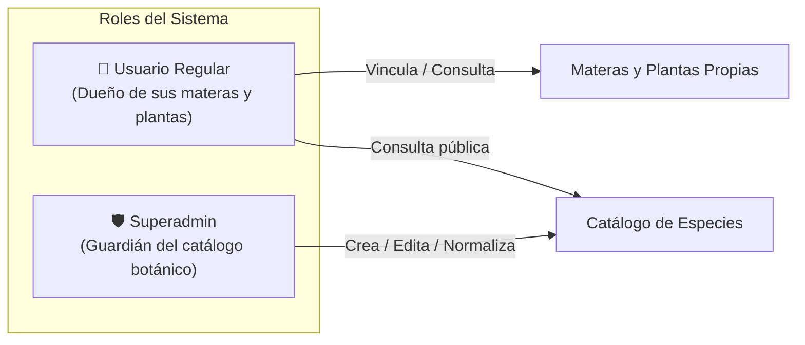
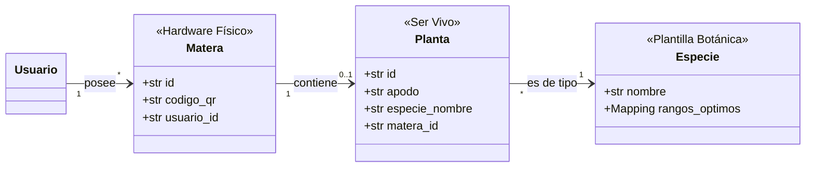
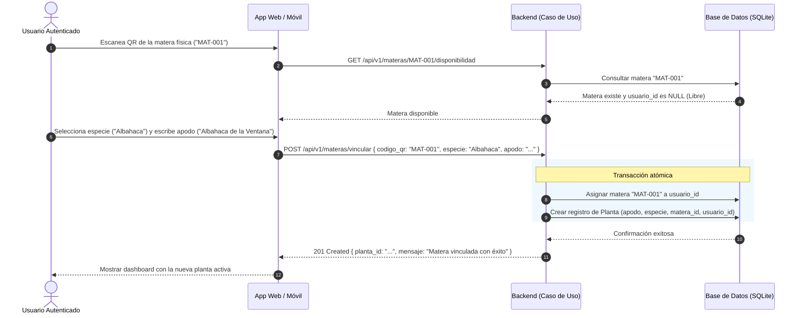

# Diseño de Gestión de Usuarios, Catálogo Botánico y Vinculación de Matera (Versión Simplificada)
**Proyecto Matera Inteligente · SmartPlantBase**  
**Asignatura:** Arquitectura de Software · Semestre 2026-2  
**Autor:** Esteban (con apoyo del College Agent)

---

## 1. Enfoque y Propósito

El objetivo de este documento es definir un modelo **claro, directo y libre de sobreingeniería** para:
1. Gestionar usuarios y proteger el catálogo de especies botánicas.
2. Modelar con precisión la diferencia entre el hardware (**matera**), el ser vivo (**planta/mata**) y la plantilla agronómica (**especie**).
3. Establecer un flujo simple y transparente de vinculación mediante **código QR**.

> **Criterio de Proporcionalidad (Anti-Overengineering Gate):**  
> Este diseño elimina abstracciones prematuras (como criptografía compleja de hardware, tokens de aprovisionamiento de fábrica a 128 bits, sincronización RTC/NTP o memoria flash NVS). Un estudiante de ciencias de la computación debe poder dibujar este modelo en un tablero y **defenderlo con total soltura en 5 minutos** frente al profesor.

---

## 2. Roles y Gestión de Usuarios

Para mantener el sistema seguro y ordenado, se definen únicamente **dos roles**:



### 2.1 El Usuario Regular (`USER`)
- Se registra con su correo y contraseña.
- Es el dueño de sus materas físicas y de las plantas que siembra en ellas.
- Puede consultar el catálogo botánico para saber qué especies están soportadas.
- **Restricción clave:** **NO puede crear especies en el catálogo global.**

---

### 2.2 El Superadmin (`SUPERADMIN`)
- Usuario con permisos especiales de administración.
- Es el **único autorizado** para dar de alta nuevas especies botánicas en el sistema (`POST /api/v1/especies`), definiendo sus rangos óptimos de humedad, luz y temperatura.

---

### 2.3 ¿Por qué es INDISPENSABLE un Superadmin para las especies?

Esta es una decisión central de arquitectura y modelo de negocio que responde a dos problemas graves:

1. **El Problema del Catálogo Caótico (Duplicados y Basura):**  
   Si permitimos que cualquier usuario cree especies, en dos semanas la base de datos tendrá:
   - `"Tomate"`
   - `"tomate"`
   - `"Tomate cherry"`
   - `"tomatico"`
   - `"Solanum lycopersicum"`  
   Cada uno creado por un usuario distinto, fragmentando el catálogo y haciendo imposible la búsqueda y el análisis estadístico.

2. **El Problema de la Integridad Agronómica:**  
   El núcleo de este proyecto es el **motor de diagnóstico botánico** (`EvaluadorDiagnostico`), que compara lecturas de sensores contra rangos de referencia óptimos.  
   - Si un usuario cualquiera ingresa una especie con rangos inventados o absurdos (ej. temperatura óptima de 95°C o humedad del 2%), el motor emitirá recomendaciones peligrosas o erróneas.
   - **El Superadmin actúa como curador botánico:** garantiza que toda especie registrada tenga base agronómica real y respete los límites físicos del dominio.

---

## 3. Modelo Conceptual: La Tríada Clave

Uno de los errores más comunes al modelar este sistema es fusionar la matera con la planta. En la realidad son tres conceptos totalmente distintos:



### Comparación Pedagógica Directa

| Concepto | ¿Qué es en la vida real? | ¿Quién lo crea/administra? | Identificador | Ejemplo |
| :--- | :--- | :--- | :--- | :--- |
| **Especie** | La ficha o plantilla botánica con los requerimientos óptimos de vida. | **Superadmin** | Nombre normalizado | `"Albahaca"`, `"Sansevieria"` |
| **Matera** | El contenedor físico plástico/cerámico que tiene el circuito electrónico por dentro. | Sistema / Fabricante | Código QR único | `"MAT-001"`, `"MAT-002"` |
| **Planta / Mata** | El ser vivo particular sembrado por el usuario en su matera. | **Usuario regular** | ID autogenerado | *"Mi Albahaca de la cocina"* |

### La Pregunta Clave de Sustentación Oral:
> **Profesor:** *"¿Por qué separaron Matera de Planta en entidades distintas en lugar de tener una sola tabla?"*  
> **Respuesta del Estudiante:**  
> *"Porque la matera es un activo físico de hardware reutilizable, mientras que la planta es un ser vivo perecedero. Si la albahaca se marchita o el usuario decide regalarla, el usuario retira la tierra y puede sembrar un cactus en la MISMA matera física. Separar ambas entidades permite reutilizar la matera `MAT-001` sin perder el histórico de la planta anterior ni tener que borrar el hardware del sistema."*

---

## 4. El ESP32: Principio de la Caja Negra

Para evitar caer en la complejidad innecesaria que sobrecargó diseños anteriores, establecemos una regla tajante:

> **Regla de Alcance:**  
> En esta fase de usuarios y vinculación, **el ESP32 se trata estrictamente como una caja negra**.  
> - Sabemos que es el microcontrolador que va físicamente empotrado dentro de la matera y que lee los sensores.
> - **NO** modelamos pines GPIO, ni firmware, ni librerías de Arduino/C++, ni certificados TLS de hardware, ni consumo de batería, ni protocolos MQTT.
> - Para el software de gestión, la matera física existe a través de su **código QR**. La telemetría se conectará en su momento como un adaptador de entrada más, sin afectar este modelo.

---

## 5. Flujo de Vinculación con Código QR

### 5.1 ¿Qué contiene el Código QR?
El código QR pegado físicamente en la matera contiene un identificador simple y legible:
- Opción texto directo: `MAT-001`
- O JSON plano: `{"matera_id": "MAT-001"}`

No requiere hashes criptográficos complejos ni secretos de 128 bits para el alcance universitario.

---

### 5.2 Secuencia de Vinculación



### Reglas de Negocio en la Vinculación:
1. **Matera Inexistente:** Si el QR leído no existe en la base de datos, el sistema retorna error `404 Not Found` ("Matera no reconocida").
2. **Matera Ocupada:** Si la matera ya tiene un `usuario_id` asignado diferente al usuario actual, el sistema rechaza la vinculación con `409 Conflict` ("Esta matera ya pertenece a otro usuario").
3. **Especie Válida:** La especie ingresada debe existir previamente en el catálogo oficial (`EspecieRepository`).
4. **Desvinculación:** Si el usuario decide liberar la matera, la planta se marca como inactiva/archivada y el campo `usuario_id` de la matera vuelve a quedar `NULL`, lista para ser vinculada por cualquier otro usuario.

---

## 6. Alineación con Clean Architecture (SmartPlantBase)

El diseño se integra armónicamente con la base existente del proyecto sin romper ninguna regla establecida:

```
src/
├── domain/                      # Reglas de negocio puras (Python puro, 0 librerías)
│   ├── entities.py              # Invarianza: Se preservan Medicion, Especie, etc.
│   │                            # Nuevas: Usuario, RolUsuario, Matera, Planta
│   ├── rules.py                 # EvaluadorDiagnostico (INTACTO, 0 cambios)
│   └── repositories.py          # Interfaces abstractas: EspecieRepo, UsuarioRepo, MateraRepo, PlantaRepo
├── application/                 # Casos de uso de orquestación
│   ├── dtos.py                  # DTOs de entrada y salida
│   └── use_cases.py             # RegistrarUsuario, Autenticar, CrearEspecie, VincularMatera
├── infrastructure/              # Adaptadores de persistencia
│   └── repositories/
│       ├── csv_especie_repository.py      # Existente
│       └── sqlite_repositories.py         # Tablas simples en SQLite
└── presentation/                # Controladores HTTP (Flask)
    └── controllers.py           # Rutas públicas y protegidas
```

### 6.1 Nuevas Entidades de Dominio (`src/domain/entities.py`)

Clases puras usando `@dataclass` estándar de Python:

```python
from dataclasses import dataclass
from enum import Enum
from typing import Optional
from datetime import datetime

class RolUsuario(str, Enum):
    USER = "USER"
    SUPERADMIN = "SUPERADMIN"

@dataclass
class Usuario:
    id: str
    email: str
    password_hash: str
    nombre: str
    rol: RolUsuario = RolUsuario.USER
    activo: bool = True

    def es_superadmin(self) -> bool:
        return self.rol == RolUsuario.SUPERADMIN

@dataclass
class Matera:
    id: str                  # Ej: "MAT-001"
    codigo_qr: str           # Contenido del QR físico
    usuario_id: Optional[str] = None  # None indica que está disponible

    @property
    def esta_disponible(self) -> bool:
        return self.usuario_id is None

@dataclass
class Planta:
    id: str
    usuario_id: str
    matera_id: str
    especie_nombre: str
    apodo: str
    creada_en: datetime
    activa: bool = True
```

> **Invarianza del Núcleo Botánico:**  
> Las entidades `Medicion`, `Diagnostico`, `LimiteFisico` y la clase `EvaluadorDiagnostico` **no sufren una sola modificación**. La arquitectura limpia garantiza que agregar usuarios y materas sea una extensión perimetral.

---

### 6.2 Casos de Uso Clave (`src/application/use_cases.py`)

1. **`RegistrarUsuarioUseCase` & `AutenticarUsuarioUseCase`**:
   - Manejo simple de credenciales con hash estándar.
2. **`CrearEspecieUseCase`**:
   - Recibe el `solicitante_id`. Consulta al repositorio de usuarios; si no es `SUPERADMIN`, lanza `PermisoDenegadoError`.
   - Si es superadmin, valida rangos físicos con `LIMITES_FISICOS` y guarda la especie en el catálogo.
3. **`VincularMateraConQRUseCase`**:
   - Orquesta:
     1. Buscar matera por `codigo_qr`.
     2. Validar que `matera.esta_disponible`.
     3. Verificar que la `especie` exista en el catálogo.
     4. Asociar `matera.usuario_id = usuario.id`.
     5. Crear y persistir la `Planta` asociada.
4. **`ListarPlantasDeUsuarioUseCase`**:
   - Devuelve las plantas activas del usuario con su matera y especie.

---

### 6.3 Modelo Relacional Simple (SQLite)

Persistencia pragmática mediante SQLite, sin configuraciones complejas de servidores de bases de datos:

```sql
-- Usuarios del sistema
CREATE TABLE usuarios (
    id TEXT PRIMARY KEY,
    email TEXT UNIQUE NOT NULL,
    password_hash TEXT NOT NULL,
    nombre TEXT NOT NULL,
    rol TEXT NOT NULL DEFAULT 'USER',
    activo INTEGER NOT NULL DEFAULT 1
);

-- Materas físicas (con circuito ESP32 adentro)
CREATE TABLE materas (
    id TEXT PRIMARY KEY,
    codigo_qr TEXT UNIQUE NOT NULL,
    usuario_id TEXT NULL,
    FOREIGN KEY (usuario_id) REFERENCES usuarios(id)
);

-- Plantas de los usuarios
CREATE TABLE plantas (
    id TEXT PRIMARY KEY,
    usuario_id TEXT NOT NULL,
    matera_id TEXT NOT NULL,
    especie_nombre TEXT NOT NULL,
    apodo TEXT NOT NULL,
    creada_en TEXT NOT NULL,
    activa INTEGER NOT NULL DEFAULT 1,
    FOREIGN KEY (usuario_id) REFERENCES usuarios(id),
    FOREIGN KEY (matera_id) REFERENCES materas(id)
);
```

---

## 7. Guía de Sustentación Oral (5 Minutos en Tablero)

Para presentar y defender este diseño ante el docente de Arquitectura de Software, apóyate en estos 4 puntos clave:

```
                     ┌───────────────────────────────┐
                     │          SUPERADMIN           │
                     └──────────────┬────────────────┘
                                    │ Administra exclusivamente
                                    ▼
┌──────────────┐     posee    ┌──────────┐   es de tipo   ┌───────────────┐
│   USUARIO    ├─────────────►│  MATERA  ├───────────────►│    ESPECIE    │
│  (Regular)   │              │ (QR Fís) │                │  (Catálogo)   │
└──────┬───────┘              └────┬─────┘                └───────────────┘
       │                           │
       │     siembra y nombra      │
       └──────────────────────────►│ PLANTA (Ser vivo: "Mi Albahaca")
```

1. **"¿Por qué un Superadmin?"**  
   *Para blindar la integridad del catálogo. Si cualquier usuario crea especies, se colapsa la base de datos con duplicados inconsistentes y valores fuera de la realidad agronómica que harían fallar al evaluador botánico.*
2. **"¿Por qué Matera no es lo mismo que Planta?"**  
   *Porque la matera es el hardware reutilizable (el recipiente físico con el circuito adentro) y la planta es el ser vivo. Si la planta muere, la matera física sigue sirviendo para sembrar otra especie.*
3. **"¿Cómo funciona el QR?"**  
   *El QR contiene el ID de la matera (`MAT-001`). El usuario lo escanea, la aplicación valida que la matera esté libre, y el usuario le asigna qué especie del catálogo tiene sembrada y un apodo.*
4. **"¿Y el ESP32?"**  
   *El ESP32 es el componente de hardware dentro de la matera. En este nivel de abstracción de gestión de usuarios y plantas se trata como una caja negra; el firmware y la ingesta de telemetría se acoplan en la siguiente fase respetando la arquitectura limpia.*
