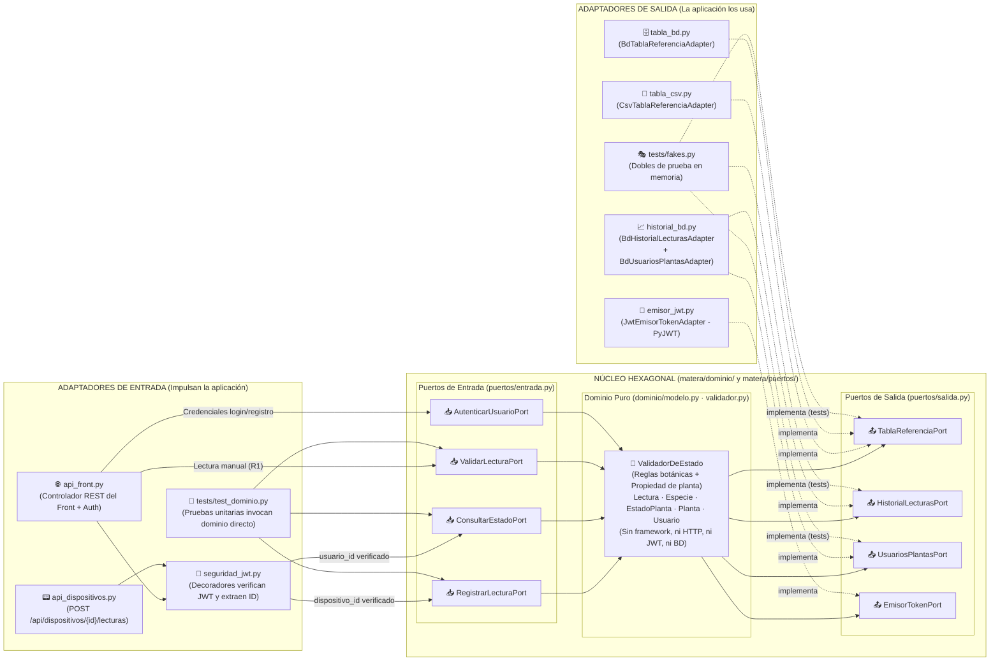

# Plan de Trabajo y Propuesta de Arquitectura — Fase 2: Arquitectura Hexagonal
**Proyecto Matera Inteligente · SmartPlantBase**  
**Asignatura:** Arquitectura de Software · Semestre 2026-3 · Universidad Sergio Arboleda  
**Modalidad:** Proyecto en Grupo · Entrega 2 (Del sensor al dominio: puertos y adaptadores)  
**Framework y Lenguaje:** Python 3.14 / Flask  
**Documento Base Oficial:** [enunciado_proyecto_fase2_arquitectura.pdf](file:///home/esteban/Documents/COLLEGE/2026-2/ARQUIT/SmartPlantBase/enunciado_proyecto_fase2_arquitectura.pdf)

---

## 1. Resumen Ejecutivo y Alineación con el Enunciado

En la Fase 1 se construyó una aplicación web tipo API en Flask separada por capas, con un evaluador botánico que valida humedad, nivel de luz y temperatura frente a una tabla de referencia en CSV, desacoplado de la infraestructura y cubierto por pruebas unitarias aisladas, junto con un frontend estático asíncrono.

La **Fase 2** pone a prueba la promesa de contar con una lógica de negocio verdaderamente agnóstica migrando explícitamente hacia una **Arquitectura Hexagonal (Puertos y Adaptadores — Alistair Cockburn, 2005)**:
1. **Conservar la validación de Fase 1 (R1):** La validación desde el frontend sigue funcionando, ahora detrás de un puerto de entrada.
2. **Del formulario al sensor (R2, R3):** Además del frontend web, las lecturas llegan periódicamente desde un dispositivo (simulado mediante el script independiente `simulador_esp32.py`) al endpoint `POST /api/dispositivos/{id}/lecturas` con identificador del dispositivo, marca de tiempo y valores medidos (incluyendo datos fuera de rango e inválidos).
3. **Tabla de referencia intercambiable (R4):** Dos implementaciones del mismo puerto de salida (`TablaReferenciaPort`: CSV en `tabla_csv.py` y Base de Datos en `tabla_bd.py`), seleccionables por configuración sin tocar ni una línea del dominio.
4. **Historial de lecturas y Front asíncrono con Polling (R5, R6):** Persistencia de las lecturas recibidas (`HistorialLecturasPort` en `historial_bd.py`), consulta de la lectura más reciente y del historial por planta/dispositivo, y actualización automática en el frontend separado mediante consulta periódica (`setInterval` + `fetch`).
5. **Seguridad con JWT afuera del dominio (R7):** Registro e inicio de sesión de usuarios; emisión de tokens detrás del puerto de salida `EmisorTokenPort` (implementado con `PyJWT` en `emisor_jwt.py`); verificación en el adaptador de entrada (`seguridad_jwt.py`) que entrega al caso de uso únicamente una identidad ya verificada (`usuario_id` o `dispositivo_id`), mientras la regla de negocio *"un usuario solo ve sus plantas"* vive en el dominio. Tokens segregados: JWT de usuario para el front y token de dispositivo con alcance limitado a reportar lecturas de su planta.

---

## 2. Marco de Decisión y Juicio de Proporcionalidad (`decision-judgment`)

Sometemos la arquitectura al **Protocolo de los 4 Lentes** y al **Anti-Overengineering Gate** para garantizar que cumplimos el 100% de la rúbrica sin introducir complejidad artificial ni código que complique la sustentación oral:

```
┌────────────────────────────────────────────────────────────────────────┐
│             PROTOCOLO DE JUICIO Y PROPORCIONALIDAD (4 LENTES)         │
└────────────────────────────────────────────────────────────────────────┘
        │                                                │
        ▼                                                ▼
  1. BELIEVER (Defensa Técnica)                    2. SKEPTIC (Auditoría Anti-Slop)
  • Cumple 100% R1-R7 y las 6 restricciones.       • ¿Dejar WebSockets/QR en main? NO (ruido).
  • EmisorTokenPort e interfaces ABC puras.        • ¿Usar SQLAlchemy/Alembic? NO (sqlite3 basta).
  • Prueba de cambio limpia (0 archivos dominio).  • ¿Roles Superadmin/QR complejo? NO pedido.
        │                                                │
        └───────────────────────┬────────────────────────┘
                                ▼
                     3. COST & DEFENSE LOAD
                     • Estructura idéntica a la sugerida en pág. 4 del PDF.
                     • Semilla automática en BD para demo en vivo sin fricción.
                     • Flujo trazable en 30 segundos frente al profesor.
                                │
                                ▼
                             4. JUDGE
                     • Aislar experimento WebSocket/QR en otra rama antes de iniciar.
                     • Implementar arquitectura hexagonal canónica en paquete matera/.
```

### 2.1 Decisiones de Proporcionalidad Clave

1. **Aislar código experimental no solicitado (Higiene de Repositorio — Paso 0):**
   - Actualmente el árbol de trabajo tiene modificaciones sin confirmar con `Flask-SocketIO` y sesiones de vinculación QR (`SesionQR`).
   - El enunciado de Fase 2 pide explícitamente **consulta periódica a la API (polling HTTP)** en R6 y **JWT estándar** en R7; no pide WebSockets ni login por QR. Dejar `Flask-SocketIO` y `SesionQR` dentro del dominio botánico añadiría ~600 líneas ajenas a la rúbrica y abriría flancos innecesarios en la sustentación oral.
   - **Acción (Paso 0):** Respaldar esos cambios en una rama separada (`feature/websocket-qr`) y restaurar `main` al commit limpio de Fase 1 (`e530488`) antes de comenzar la Fase 2.
2. **Descartar roles `SUPERADMIN` y emparejamiento QR de 3 tablas:**
   - El requisito R7 pide: *"Registro e inicio de sesión de usuarios; cada planta pertenece a un usuario y solo él consulta su estado e historial."* No exige un rol `SUPERADMIN` ni creación dinámica de especies por API (en R4 las especies provienen de `TablaReferenciaPort` en CSV o BD). Mantendremos el modelo de datos mínimo, directo y 100% enfocado en R1–R7.
3. **Módulo nativo `sqlite3` en lugar de ORMs pesados (SQLAlchemy / Alembic):**
   - `sqlite3` viene en la librería estándar de Python, soporta archivo local (`data/matera.db`) y modo en memoria (`:memory:`) para pruebas de integración, no añade dependencias externas y permite explicar cada consulta SQL en sustentación sin magia oculta.
4. **Inyección de dependencias manual en el Punto Único de Composición (`matera/app.py`):**
   - Tal como exige la Sección 2 y 4 del enunciado (`main / create_app() en Flask`), un único archivo instancia los adaptadores de salida, los inyecta en los servicios del dominio (puertos de entrada) y conecta los blueprints de entrada.

---

## 3. Matriz Quirúrgica: Enunciado vs. Solución Arquitectónica

| Elemento del Enunciado | Especificación Oficial (PDF) | Solución en nuestro Proyecto (`matera/`) | Verificación |
| :--- | :--- | :--- | :--- |
| **Concepto: Dominio** (Pág. 1) | Reglas de negocio puras. Sin imports de framework ni de infraestructura. Validar si una lectura está en rango y calcular estado. | `matera/dominio/modelo.py` (`Lectura`, `Especie`, `EstadoPlanta`, `Diagnostico`, `Planta`, `Usuario`) y `matera/dominio/validador.py` (`ValidadorDeEstado` + servicios de dominio). | `grep` verifica 0 imports de `flask`, `sqlite3`, `csv`, `json`, `jwt` o `requests`. |
| **Concepto: Puerto de entrada** (Pág. 1-2) | Interfaz que expone un caso de uso a quien quiera invocarlo (`RegistrarLecturaPort`, `ConsultarEstadoPort`). | `matera/puertos/entrada.py`: `RegistrarLecturaPort`, `ConsultarEstadoPort`, `ValidarLecturaPort` (R1), `AutenticarUsuarioPort` (R7). | Clases abstractas (`ABC`) definidas por el dominio. |
| **Concepto: Puerto de salida** (Pág. 1-2) | Interfaz que el dominio necesita y que otro implementa (`TablaReferenciaPort`, `HistorialLecturasPort`, `EmisorTokenPort`). | `matera/puertos/salida.py`: `TablaReferenciaPort`, `HistorialLecturasPort`, `UsuariosPlantasPort`, `EmisorTokenPort`. | Clases abstractas (`ABC`) sin detalles tecnológicos. |
| **Concepto: Seguridad JWT** (Pág. 2) | Filtro/decorador de entrada valida el token y entrega un `UsuarioId`, nunca el token. `EmisorTokenPort` lo implementa la librería JWT. | Entrada: `matera/adaptadores/entrada/seguridad_jwt.py` (`@requiere_jwt_usuario`, `@requiere_jwt_dispositivo`).<br>Salida: `matera/adaptadores/salida/emisor_jwt.py` implementa `EmisorTokenPort` con `PyJWT`. | El dominio jamás recibe un token ni importa `jwt`; sí evalúa `planta.usuario_id == usuario_id`. |
| **Concepto: Composición** (Pág. 2) | Único lugar donde se decide qué adaptador se conecta a qué puerto (`create_app()` en Flask). | `matera/app.py` (con punto de entrada raíz `app.py`). Lee `TABLA_REFERENCIA_DRIVER` (`csv` o `bd`) e inyecta dependencias. | Ningún adaptador se instancia dentro de `dominio/` ni `puertos/`. |
| **R1. Conservar validación** (Pág. 2) | La validación de la fase anterior sigue funcionando desde el front, ahora detrás de un puerto de entrada. | `POST /api/v1/diagnosticos` en `api_front.py` invoca `ValidarLecturaPort` (implementado por `ValidadorDeEstado`). | Tests existentes y formulario interactivo siguen funcionando al 100%. |
| **R2. Adaptador dispositivos** (Pág. 2) | Endpoint `POST /api/dispositivos/{id}/lecturas` con id del dispositivo, marca de tiempo y valores medidos. | `matera/adaptadores/entrada/api_dispositivos.py` valida JSON + token de dispositivo y llama a `RegistrarLecturaPort.ejecutar(...)`. | Retorna `201 Created` con el diagnóstico calculado y guardado. |
| **R3. Simulador del ESP32** (Pág. 3) | Script independiente (`simulador_esp32.py`) con intervalo configurable, valores fuera de rango y algún dato inválido. | `simulador_esp32.py` en la raíz del proyecto. Envía lecturas periódicas con JWT de dispositivo (`scope="dispositivo"`). | Genera lecturas óptimas, fuera de rango (`EN_RIESGO`/`CRITICO`) e inválidas (`400 Bad Request`). |
| **R4. Tabla intercambiable** (Pág. 3) | Dos implementaciones del mismo puerto (`CSV` y `BD`), elegidas por configuración sin tocar el dominio. | `tabla_csv.py` (`CsvTablaReferenciaAdapter`) y `tabla_bd.py` (`BdTablaReferenciaAdapter`) implementan `TablaReferenciaPort`. | Conmutación en vivo con `TABLA_REFERENCIA_DRIVER=csv` vs `bd`. |
| **R5. Historial de lecturas** (Pág. 3) | Persistir lecturas recibidas y consultar la más reciente y el historial por dispositivo o planta. | `historial_bd.py` implementa `HistorialLecturasPort` (`guardar_lectura`, `obtener_ultima`, `obtener_historial`). | Expuesto en `GET /api/plantas/{id}/estado` y `GET /api/plantas/{id}/historial`. |
| **R6. Front asíncrono** (Pág. 3) | El front separado muestra el estado actual de la planta y se actualiza solo (consulta periódica a la API). | `frontend/` realiza polling periódico (`setInterval` cada 3 s con `fetch` y header `Authorization: Bearer`) al endpoint de estado/historial. | El navegador refleja en vivo cada lectura enviada por `simulador_esp32.py`. |
| **R7. Autenticación con JWT** (Pág. 3) | Registro y login de usuarios; cada planta pertenece a un usuario y solo él consulta su estado/historial; dispositivos usan su propio token con alcance limitado a su planta. | Registro (`POST /api/auth/registro`), Login (`POST /api/auth/login`), token usuario (`scope="usuario"`) vs token dispositivo (`scope="dispositivo"`, `planta_id`, `dispositivo_id`). | Intento de acceso a una planta ajena lanza `AccesoNoAutorizadoPlantaError` en el dominio (`403 Forbidden`). |

---

## 4. Diseño Detallado de la Arquitectura Hexagonal

### 4.1 Diagrama Hexagonal Propio (Alineado con Clases, Puertos y Adaptadores Reales)



---

## 5. Especificación Formal de Modelos, Puertos y Dominio

### 5.1 Entidades y Objetos de Valor del Dominio (`matera/dominio/modelo.py`)

El modelo conserva la validación de límites físicos e indexación dinámica de parámetros de la Fase 1 (`LIMITES_FISICOS`, `RangoParametro`, `Especie`, `ParametroEvaluado`, `Diagnostico`, `EstadoPlanta`) e incorpora las entidades de Fase 2 **desde el Commit 1**, de modo que el dominio no tenga que tocarse cuando entre el adaptador del ESP32 en el Commit 4:

```python
@dataclass(frozen=True)
class Lectura:
    """
    Lectura ambiental reportada por un sensor (ESP32) o ingresada manualmente.
    Valida límites físicos al construirse (humedad 0-100%, luz 0-150000 lux, temp -50 a 80°C).
    """
    especie: str
    valores: Mapping[str, float]
    marca_tiempo: str = ""                 # ISO-8601 timestamp (R2)
    dispositivo_id: Optional[str] = None   # Identificador del dispositivo que reporta (R2)
    planta_id: Optional[str] = None        # Identificador de la planta asociada (R5, R7)

@dataclass(frozen=True)
class Planta:
    """Planta registrada que pertenece a un usuario específico y está asociada a un dispositivo."""
    id: str
    nombre: str
    especie: str
    usuario_id: str
    dispositivo_id: str

    def pertenece_a(self, usuario_id: str) -> bool:
        """Regla de negocio de propiedad en el dominio (Sección 4 del enunciado)."""
        return self.usuario_id == usuario_id

@dataclass(frozen=True)
class Usuario:
    """Usuario propietario de una o más plantas."""
    id: str
    nombre: str
    email: str
    password_hash: str

@dataclass(frozen=True)
class EstadoActualPlanta:
    """Vista agregada del estado actual de una planta a partir de su última lectura."""
    planta: Planta
    ultima_lectura: Optional[Lectura]
    diagnostico: Optional[Diagnostico]
```

### 5.2 Puertos de Entrada (`matera/puertos/entrada.py`)

Definidos por el dominio usando `abc.ABC`:

```python
from abc import ABC, abstractmethod
from typing import Dict, List, Mapping
from matera.dominio.modelo import Diagnostico, Especie, EstadoActualPlanta, Lectura, Planta

class ValidarLecturaPort(ABC):
    """R1: Conserva la validación directa de una lectura desde el front contra la tabla de referencia."""
    @abstractmethod
    def validar(self, especie: str, valores: Mapping[str, float]) -> Diagnostico:
        pass

    @abstractmethod
    def listar_especies(self) -> List[Especie]:
        pass

class RegistrarLecturaPort(ABC):
    """R2 y R5: Registra una lectura proveniente de un dispositivo, calcula su estado y la persiste."""
    @abstractmethod
    def registrar(
        self,
        dispositivo_id: str,
        valores: Mapping[str, float],
        marca_tiempo: str,
    ) -> Diagnostico:
        pass

class ConsultarEstadoPort(ABC):
    """R5, R6 y R7: Consulta el estado actual y el historial de una planta verificando propiedad."""
    @abstractmethod
    def consultar_estado(self, usuario_id: str, planta_id: str) -> EstadoActualPlanta:
        pass

    @abstractmethod
    def consultar_historial(
        self, usuario_id: str, planta_id: str, limite: int = 20
    ) -> List[Dict]:
        pass

    @abstractmethod
    def listar_plantas_usuario(self, usuario_id: str) -> List[Planta]:
        pass

class AutenticarUsuarioPort(ABC):
    """R7: Caso de uso de registro e inicio de sesión de usuarios y emisión de tokens vía EmisorTokenPort."""
    @abstractmethod
    def registrar_usuario(self, nombre: str, email: str, password: str) -> Dict[str, str]:
        pass

    @abstractmethod
    def iniciar_sesion(self, email: str, password: str) -> Dict[str, str]:
        pass
```

### 5.3 Puertos de Salida (`matera/puertos/salida.py`)

Interfaces pequeñas y segregadas (principio `I` de SOLID) declaradas por el dominio e implementadas por los adaptadores de salida:

```python
from abc import ABC, abstractmethod
from typing import Dict, List, Optional
from matera.dominio.modelo import Diagnostico, Especie, Lectura, Planta, Usuario

class TablaReferenciaPort(ABC):
    """P3 (R4): Contrato para obtener los rangos óptimos de las especies (implementado en CSV y BD)."""
    @abstractmethod
    def obtener_por_nombre(self, nombre: str) -> Optional[Especie]:
        pass

    @abstractmethod
    def obtener_todas(self) -> List[Especie]:
        pass

class HistorialLecturasPort(ABC):
    """P4 (R5): Contrato para persistir y consultar lecturas históricas por planta o dispositivo."""
    @abstractmethod
    def guardar_lectura(self, lectura: Lectura, diagnostico: Diagnostico) -> None:
        pass

    @abstractmethod
    def obtener_ultima_lectura(self, planta_id: str) -> Optional[Lectura]:
        pass

    @abstractmethod
    def obtener_historial(self, planta_id: str, limite: int = 20) -> List[Lectura]:
        pass

class UsuariosPlantasPort(ABC):
    """Contrato de salida para persistir usuarios y consultar la relación usuario-planta-dispositivo."""
    @abstractmethod
    def guardar_usuario(self, usuario: Usuario) -> None:
        pass

    @abstractmethod
    def obtener_usuario_por_email(self, email: str) -> Optional[Usuario]:
        pass

    @abstractmethod
    def obtener_usuario_por_id(self, usuario_id: str) -> Optional[Usuario]:
        pass

    @abstractmethod
    def obtener_planta_por_id(self, planta_id: str) -> Optional[Planta]:
        pass

    @abstractmethod
    def obtener_planta_por_dispositivo(self, dispositivo_id: str) -> Optional[Planta]:
        pass

    @abstractmethod
    def listar_plantas_por_usuario(self, usuario_id: str) -> List[Planta]:
        pass

    @abstractmethod
    def guardar_planta(self, planta: Planta) -> None:
        pass

class EmisorTokenPort(ABC):
    """
    Puerto de salida para emisión de tokens (Pág. 2 del enunciado:
    'EmisorTokenPort lo implementa la librería JWT').
    """
    @abstractmethod
    def emitir_token_usuario(self, usuario_id: str, email: str) -> str:
        pass

    @abstractmethod
    def emitir_token_dispositivo(self, dispositivo_id: str, planta_id: str) -> str:
        pass
```

---

## 6. Seguridad con JWT y Persistencia SQLite (R4, R5, R7)

### 6.1 Dónde se Emite y Dónde se Verifica el JWT (Requisito de Documento y Rúbrica 10%)

El enunciado (Págs. 2, 3 y 4) pide explicar con precisión dónde se emite y dónde se verifica el JWT sin contaminar el dominio:

```
┌──────────────────────────────────────────────────────────────────────────────┐
│ 1. EMISIÓN DEL JWT (Puerto de Salida: EmisorTokenPort -> emisor_jwt.py)      │
├──────────────────────────────────────────────────────────────────────────────┤
│ • El usuario hace POST /api/auth/login o /api/auth/registro en api_front.py. │
│ • El caso de uso AutenticarUsuarioServicio valida credenciales y solicita    │
│   un token llamando a self._emisor_token.emitir_token_usuario(usuario.id).   │
│ • El adaptador de salida JwtEmisorTokenAdapter (en adaptadores/salida/       │
│   emisor_jwt.py) es el ÚNICO que importa PyJWT y firma el token con HS256.   │
└──────────────────────────────────────────────────────────────────────────────┘
                                       │
                                       ▼
┌──────────────────────────────────────────────────────────────────────────────┐
│ 2. VERIFICACIÓN DEL JWT (Adaptador de Entrada: seguridad_jwt.py)             │
├──────────────────────────────────────────────────────────────────────────────┤
│ • Petición HTTP llega con cabecera 'Authorization: Bearer <token>'.          │
│ • El decorador en seguridad_jwt.py (@requiere_jwt_usuario o                  │
│   @requiere_jwt_dispositivo) verifica la firma, expiración y el claim        │
│   'scope' ('usuario' vs 'dispositivo').                                      │
│ • Si un token de dispositivo intenta llamar a un endpoint del front (o       │
│   viceversa), el decorador rechaza con 403 Forbidden en el borde.            │
│ • Si un token del dispositivo 'esp32-01' intenta reportar en la URL de       │
│   '/api/dispositivos/esp32-02/lecturas', el adaptador rechaza con 403.       │
│ • El adaptador extrae el string puro `usuario_id` (o `dispositivo_id`) y     │
│   lo pasa como parámetro al puerto de entrada. El dominio NUNCA ve el token. │
└──────────────────────────────────────────────────────────────────────────────┘
                                       │
                                       ▼
┌──────────────────────────────────────────────────────────────────────────────┐
│ 3. REGLA DE PROPIEDAD (En el Dominio: matera/dominio/validador.py)           │
├──────────────────────────────────────────────────────────────────────────────┤
│ • ConsultarEstadoPort recibe `usuario_id: str` y `planta_id: str`.           │
│ • El dominio obtiene la entidad `Planta` y ejecuta la regla de negocio:      │
│       if not planta.pertenece_a(usuario_id):                                 │
│           raise AccesoNoAutorizadoPlantaError(usuario_id, planta_id)         │
│ • Si otro usuario intenta consultar una planta ajena, el dominio lo impide.  │
└──────────────────────────────────────────────────────────────────────────────┘
```

### 6.2 Alcances Segregados de los Tokens (Scopes)

| Tipo de Token | Claim `scope` | Claims Incluidos | Endpoints Permitidos | Restricción de Alcance |
| :--- | :--- | :--- | :--- | :--- |
| **Token de Usuario** | `"usuario"` | `sub` (`usuario_id`), `email`, `scope: "usuario"`, `exp` | `GET /api/plantas`, `GET /api/plantas/{id}/estado`, `GET /api/plantas/{id}/historial`, `POST /api/plantas` | Rechazado (`403`) en `/api/dispositivos/*`. En el dominio solo puede ver plantas donde `planta.usuario_id == sub`. |
| **Token de Dispositivo** | `"dispositivo"` | `sub` (`dispositivo_id`), `planta_id`, `scope: "dispositivo"`, `exp` | Únicamente `POST /api/dispositivos/{id}/lecturas` donde `{id} == sub`. | Rechazado (`403`) en todos los endpoints de usuario/front y en cualquier otro `{id}` de dispositivo distinto al suyo. |

### 6.3 Esquema SQLite y Semilla Automática para Sustentación (`matera.db`)

Para que la demostración en clase (*"simulador enviando lecturas en vivo, cambio de CSV a BD por configuración, intento de acceso a una planta ajena"*) funcione de inmediato al clonar el repositorio sin pasos manuales frágiles, la base de datos SQLite crea sus tablas (`especies`, `usuarios`, `plantas`, `historial_lecturas`) y carga de forma idempotente:
1. **Las 5 especies de referencia del Anexo B** (`sansevieria`, `potos`, `suculenta`, `helecho`, `lavanda`) en la tabla `especies` para que `BdTablaReferenciaAdapter` (`tabla_bd.py`) funcione de inmediato al cambiar `TABLA_REFERENCIA_DRIVER=bd`.
2. **Dos usuarios y dos plantas preconfiguradas para la demo en vivo** (además de permitir registrar nuevos usuarios por `POST /api/auth/registro`):
   - **Usuario 1 (Principal):** `ana@matera.edu.co` / `clave123` (`id="usr-ana"`) → Dueña de la planta **`planta-01`** (*"Sansevieria de Sala"*, especie `sansevieria`, vinculada al dispositivo **`esp32-01`**).
   - **Usuario 2 (Para probar fallo de acceso ajeno):** `carlos@matera.edu.co` / `clave123` (`id="usr-carlos"`) → Dueño de la planta **`planta-02`** (*"Helecho de Balcón"*, especie `helecho`, vinculada al dispositivo **`esp32-02`**).
   - El simulador `simulador_esp32.py` puede obtener o recibir el token de dispositivo de `esp32-01` por variable de entorno/argumento CLI (o generarlo con el emisor configurado) y comenzar a transmitir en 1 comando.

---

## 7. Punto Único de Composición e Intercambio CSV vs. BD (R4)

En `matera/app.py` se conectan todas las piezas y se elige la implementación de `TablaReferenciaPort` por configuración (variable de entorno `TABLA_REFERENCIA_DRIVER`, por defecto `"csv"`):

```python
# matera/app.py
def create_app(
    driver_tabla: Optional[str] = None,
    ruta_csv: Optional[str] = None,
    ruta_bd: Optional[str] = None,
) -> Flask:
    app = Flask(__name__)
    app.json.sort_keys = False
    CORS(app, resources={r"/api/*": {"origins": "*"}})

    # 1. Selección del adaptador de TablaReferenciaPort por configuración (R4)
    modo_tabla = (driver_tabla or os.getenv("TABLA_REFERENCIA_DRIVER", "csv")).strip().lower()
    if modo_tabla == "bd":
        tabla_referencia = BdTablaReferenciaAdapter(ruta_bd)
    else:
        tabla_referencia = CsvTablaReferenciaAdapter(ruta_csv)

    # 2. Adaptadores de salida restantes (Historial, Usuarios/Plantas, Emisor JWT)
    persistencia_bd = BdHistorialYPlantasAdapter(ruta_bd)
    emisor_token = JwtEmisorTokenAdapter(secret_key=os.getenv("JWT_SECRET", "matera-secret-2026"))

    # 3. Instanciación del núcleo de dominio (Casos de uso / Puertos de entrada)
    servicio_dominio = ServicioMateraDominio(
        tabla_referencia=tabla_referencia,
        historial_lecturas=persistencia_bd,
        usuarios_plantas=persistencia_bd,
        emisor_token=emisor_token,
    )

    # 4. Adaptadores de entrada (Blueprints HTTP)
    app.register_blueprint(crear_api_front_blueprint(servicio_dominio, emisor_token))
    app.register_blueprint(crear_api_dispositivos_blueprint(servicio_dominio, emisor_token))
    return app
```

---

## 8. Estrategia Git y "Prueba de Cambio" Garantizada (15% de la Rúbrica)

El enunciado establece en la Sección 4:
> **Prueba de cambio:** *el commit que agrega el adaptador de dispositivos y el simulador **no modifica ningún archivo del dominio**. Si lo modifica, deben explicar por qué en el documento de arquitectura.*

Para cumplir esta restricción con **cero archivos del dominio modificados**, ejecutaremos la siguiente secuencia exacta de pasos:

```
[Paso 0: Higiene de Git]
  Respaldar trabajo previo no confirmado (WebSockets / SesionQR) en rama 'feature/websocket-qr'
  y dejar 'main' limpia en el commit base de Fase 1 (e530488).
        │
        ▼
[Commit 1: refactor(hexagonal)]
  Reorganizar el proyecto en 'matera/dominio/', 'matera/puertos/' y 'matera/adaptadores/'.
  • Define 'Lectura' (con marca_tiempo y dispositivo_id), 'Planta', 'Usuario' en 'dominio/modelo.py'.
  • Define TODOS los puertos en 'puertos/entrada.py' (incluyendo RegistrarLecturaPort) y 'puertos/salida.py'.
  • Implementa 'ValidadorDeEstado' y la lógica de los puertos de entrada en 'dominio/validador.py'.
  • Migra 'tabla_csv.py', 'api_front.py' (R1) y pruebas unitarias puras con dobles ('tests/fakes.py').
        │
        ▼
[Commit 2: feat(persistencia)]
  Implementar adaptadores SQLite ('tabla_bd.py' e 'historial_bd.py') y switch por configuración
  'TABLA_REFERENCIA_DRIVER=csv|bd' en 'matera/app.py' (R4 y R5).
        │
        ▼
[Commit 3: feat(seguridad-jwt)]
  Implementar 'emisor_jwt.py' (EmisorTokenPort) y 'seguridad_jwt.py' (decoradores de verificación
  para usuario y dispositivo), endpoints de registro/login y consulta protegida en 'api_front.py' (R7).
        │
        ▼
┌──────────────────────────────────────────────────────────────────────────────┐
│ [COMMIT 4: PRUEBA DE CAMBIO] (Enlace directo en el Documento de Arquitectura)│
│ feat(dispositivos): agregar adaptador de dispositivos y simulador ESP32      │
│                                                                              │
│ Archivos creados / modificados en este commit:                               │
│   + matera/adaptadores/entrada/api_dispositivos.py                           │
│   + simulador_esp32.py                                                       │
│   ~ matera/app.py (únicamente registrar el blueprint de dispositivos)        │
│   + tests/test_api_dispositivos.py                                           │
│                                                                              │
│ Archivos tocados en matera/dominio/ y matera/puertos/: EXACTAMENTE CERO (0). │
└──────────────────────────────────────────────────────────────────────────────┘
        │
        ▼
[Commit 5: feat(frontend-docs)]
  Actualizar 'frontend/' con login JWT, consulta periódica (polling R6) e intento de acceso a
  planta ajena; actualizar 'README.md' y redactar 'docs/documento_arquitectura.md' (máx. 4 páginas).
```

---

## 9. Diseño del Simulador del ESP32 (`simulador_esp32.py` — R3)

Script independiente en Python (ejecutable desde otra terminal con `python simulador_esp32.py`) sin requerir hardware físico:
- **Configuración por argumentos CLI o variables de entorno:**
  - `--url`: URL base del backend (por defecto `http://localhost:5000`).
  - `--dispositivo-id`: ID del dispositivo (por defecto `esp32-01`).
  - `--intervalo`: Segundos entre envíos (por defecto `3.0`, configurable p. ej. `--intervalo 2`).
  - `--token`: JWT de dispositivo con alcance `scope="dispositivo"` (si no se pasa, puede usar el token semilla de `esp32-01` impreso al iniciar o solicitarlo con `--generar-token`).
  - `--iteraciones`: Número de lecturas a enviar (por defecto infinito hasta `Ctrl+C`, o un número fijo para pruebas automatizadas).
- **Ciclo de generación de datos (R3):**
  1. **Lectura en rango óptimo:** Valores saludables para la especie de la planta (ej. `humedad: 40%`, `luz: 5000 lux`, `temperatura: 22°C`) → Respuesta `201 Created` (`SALUDABLE`).
  2. **Lectura fuera de rango (alerta botánica):** Sequía o exceso térmico (ej. `humedad: 10%`, `temperatura: 36°C`) → Respuesta `201 Created` (`EN_RIESGO` o `CRITICO` con recomendaciones).
  3. **Dato inválido / sensor corrupto:** Valor físicamente imposible o malformado (ej. `humedad: 150%` o `temperatura: -999°C`) → El dominio/adaptador lo rechaza con `400 Bad Request` (`PARAMETRO_INVALIDO`) demostrando la robustez del sistema sin detener el simulador.

---

## 10. Estructura de Paquetes Final (Alineada con Página 4 del Enunciado)

Adoptamos la estructura sugerida por el profesor en la página 4 del PDF, manteniendo un `app.py` ligero en la raíz que delega en `matera/app.py` para compatibilidad total:

```
SmartPlantBase/
├── data/
│   ├── especies_referencia.csv          # Catálogo CSV de las 5 especies (Anexo B)
│   └── matera.db                        # Base de datos SQLite autogenerada
├── frontend/
│   ├── index.html                       # Dashboard asíncrono (Login + Estado en vivo + Validación R1)
│   ├── css/style.css
│   └── js/
│       ├── config.js
│       ├── api.js                       # Cliente fetch con cabeceras Authorization Bearer
│       ├── ui.js
│       └── app.js                       # Polling periódico (setInterval) y manejo de eventos
├── matera/
│   ├── __init__.py
│   ├── dominio/
│   │   ├── __init__.py
│   │   ├── modelo.py                    # Lectura, Especie, EstadoPlanta, Diagnostico, Planta, Usuario
│   │   ├── validador.py                 # ValidadorDeEstado y casos de uso del dominio
│   │   └── excepciones.py               # Excepciones puras (ParametroInvalido, AccesoNoAutorizado, etc.)
│   ├── puertos/
│   │   ├── __init__.py
│   │   ├── entrada.py                   # RegistrarLecturaPort, ConsultarEstadoPort, ValidarLecturaPort, AutenticarUsuarioPort
│   │   └── salida.py                    # TablaReferenciaPort, HistorialLecturasPort, UsuariosPlantasPort, EmisorTokenPort
│   ├── adaptadores/
│   │   ├── __init__.py
│   │   ├── entrada/
│   │   │   ├── __init__.py
│   │   │   ├── api_front.py             # Endpoints REST del front (R1, R5, R6, R7)
│   │   │   ├── api_dispositivos.py      # Endpoint REST del ESP32: POST /api/dispositivos/{id}/lecturas (R2)
│   │   │   └── seguridad_jwt.py         # Decoradores de verificación JWT por alcance (R7)
│   │   └── salida/
│   │       ├── __init__.py
│   │       ├── tabla_csv.py             # Implementación CSV de TablaReferenciaPort (R4)
│   │       ├── tabla_bd.py              # Implementación SQLite de TablaReferenciaPort (R4)
│   │       ├── historial_bd.py          # Implementación SQLite de HistorialLecturasPort y UsuariosPlantasPort (R5, R7)
│   │       └── emisor_jwt.py            # Implementación PyJWT de EmisorTokenPort (R7)
│   └── app.py                           # Único punto de composición (create_app)
├── app.py                               # Punto de arranque en raíz (importa create_app de matera.app)
├── simulador_esp32.py                   # Script independiente del simulador ESP32 (R3)
├── tests/
│   ├── fakes.py                         # Dobles de prueba en memoria para todos los puertos de salida
│   ├── test_dominio.py                  # Pruebas unitarias puras de dominio (sin servidor, ni archivos, ni BD)
│   ├── test_adaptadores_salida.py       # Pruebas de intercambiabilidad CSV vs SQLite e historial
│   ├── test_seguridad_jwt.py            # Pruebas de tokens (usuario vs dispositivo) y rechazo de planta ajena
│   └── test_api_dispositivos.py         # Pruebas de integración del endpoint de dispositivos
├── docs/
│   ├── plan_fase2_arquitectura_hexagonal.md
│   └── documento_arquitectura.md        # Entregable oficial (máximo 4 páginas)
├── requirements.txt                     # flask, flask-cors, PyJWT, pytest
└── README.md                            # Instrucciones para ejecutar back, front y simulador
```

---

## 11. Preparación de Entregables y Sustentación Oral en Clase (Secciones 5, 6 y 7)

### 11.1 Lista de Chequeo del Documento de Arquitectura (Máximo 4 Páginas — 15% junto con Sustentación)
El entregable `docs/documento_arquitectura.md` (y su exportación a PDF) respetará estrictamente el límite de **máximo 4 páginas** e incluirá los 6 puntos exigidos en la Sección 6:
1. **Diagrama hexagonal propio** con los nombres reales de clases, puertos y adaptadores de `matera/`.
2. **Tabla de puertos y sus adaptadores** indicando archivo, interfaz e implementaciones concretas.
3. **Explicación de dónde se emite (`EmisorTokenPort` -> `emisor_jwt.py`) y dónde se verifica (`seguridad_jwt.py`) el JWT**, y cómo la regla de propiedad vive en `dominio/validador.py`.
4. **Justificación de los 4 principios SOLID (D, O, I, S)** con fragmentos reales de nuestro código.
5. **Enlace directo al commit de la Prueba de Cambio** demostrando `0 files changed` en `matera/dominio/`.
6. **Análisis de cambio a MQTT:** qué archivos se crearían/modificarían si mañana las lecturas llegaran por MQTT.

### 11.2 Guion para las 4 Demostraciones en Vivo durante la Sustentación Oral
1. **Simulador enviando lecturas en vivo + Front actualizándose solo (10%):**
   - Correr backend (`python app.py`), abrir `frontend/index.html` autenticado como Ana (`ana@matera.edu.co`), y ejecutar `python simulador_esp32.py`. Mostrar cómo cada 3 segundos el frontend hace polling y refleja lecturas óptimas, alertas (`EN_RIESGO` / `CRITICO`) y el rechazo de lecturas corruptas (`400 Bad Request`).
2. **Cambio de CSV a BD por configuración sin tocar el dominio (15%):**
   - Reiniciar el backend con `TABLA_REFERENCIA_DRIVER=bd python app.py` y mostrar que el sistema lee las especies desde SQLite (`tabla_bd.py`) sin modificar ni un carácter de `matera/dominio/`.
3. **Intento de acceso a una planta ajena — debe fallar (10%):**
   - Desde la sesión de Carlos (`carlos@matera.edu.co`, `usr-carlos`) o mediante un botón directo en el dashboard ("Probar acceso a planta ajena `planta-01`"), realizar `GET /api/plantas/planta-01/estado` con el JWT de Carlos y demostrar que el dominio rechaza la petición con `403 Forbidden` (`AccesoNoAutorizadoPlantaError`). También mostrar que el token del ESP32 no puede consultar endpoints de usuario (`403 Forbidden`).
4. **Respuesta sin computador a las Preguntas de Cambio (15%):**
   - **Caso A (MQTT en lugar de HTTP):** Se crea únicamente un nuevo adaptador de entrada `matera/adaptadores/entrada/suscriptor_mqtt.py` que se suscribe al broker, traduce el mensaje JSON y llama a `RegistrarLecturaPort.registrar(...)`, registrándolo en `matera/app.py`. **No se toca ningún archivo en `matera/dominio/` ni `matera/puertos/`.**
   - **Caso B (Login con OAuth institucional en lugar de usuario/contraseña):** Se cambia el adaptador de autenticación y el verificador de tokens en `seguridad_jwt.py` para validar el token OAuth de la universidad y extraer el `usuario_id`. **`ConsultarEstadoPort` y el dominio permanecen intactos** porque solo reciben el `usuario_id` ya verificado.
